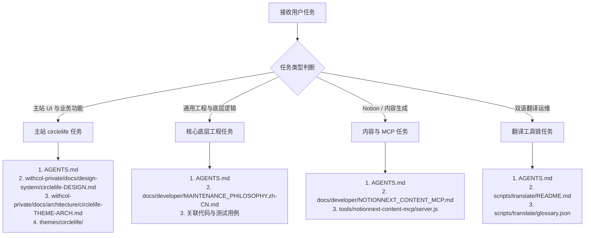

# PROJECT_MAP.md — 项目资料索引与任务分流地图

本文档为 NotionNext (Circle of Life / 时光的弧线) 项目的全局知识地图、权威裁决阶梯与任务分流导航。

---

## 一、 冲突仲裁与权威来源阶梯

当文档、历史记录或代码实现之间出现不一致时，严格按照以下裁决链判定：

0. **第零级（博主当前明确指令，最高绝对权威）**：
   * **博主在当前会话中的直接需求与裁决拥有最高优先级**。博主可随时决定尝试新版式、重构代码或调整业务。
1. **第一级（真实代码实现与本地现场底座）**：
   * `package.json`、`yarn.lock`、代码实际实现是依赖与技术栈版本（Next.js 15.x / Tailwind 3.4.x）的客观事实来源。
   * 私有凭据与交接文档已收拢至同级私有库 `../withcol-private/docs/secrets/handover.local.md`，记录的生产域名（withcol.com）、分支规范（custom_theme）、作者人设与 Vercel/Notion 私密 ID 具备最高现场权威。
   * *注：`OPTIMIZATION_SUMMARY.md`、`PROJECT_COMPLETION_REPORT.md` 属历史归档快照，记载的 Next 14 已失效，不作为当前依据。*
2. **第二级（核心维护契约与技术底线）**：
   * 工程规范遵循 `docs/developer/MAINTENANCE_PHILOSOPHY.zh-CN.md`。
   * Notion 内容读写遵循 `tools/notionnext-content-mcp/server.js` 与 `docs/developer/NOTIONNEXT_CONTENT_MCP.md` 中的“零 ext 写入契约”。
3. **第三级（活态设计规范与专项 RFC）**：
   * 主站视觉以私有库 **`withcol-private/docs/design-system/circlelife-DESIGN.md`**（当前成熟基准，本地由 AI 自动探测加载）为参考。
   * 特定主题遵循对应规范（如 `docs/design/xuhome/DESIGN.md`）。
   * 组件级交互遵循已实现的 `docs/developer/rfc/*`。
4. **第四级（维护手册与用户手册）**：
   * 开发者规范（`docs/developer/*`）优先于大众搭建手册（`docs/user-guide/*`）。

---

## 二、 现有设计与交互资料索引（Design Registry）

在执行任何涉及 UI、样式、配色、排版或交互的任务前，按需索引本表：

| 模块 / 主题 | 权威设计规范位置 | 核心范围与职责 | 适用任务类型 |
| :--- | :--- | :--- | :--- |
| **主站 Circle of Life 主题** | 1. **`withcol-private/docs/design-system/circlelife-DESIGN.md`**（本地自动探测） 2. `withcol-private/docs/architecture/circlelife-THEME-ARCH.md` 3. `themes/circlelife/styles/` | 当前成熟基准：纸感杂志风格、纸色 `#F5F0E4`、朱砂红 `#B24A33`、Newsreader / 思源宋体、1024px 导航、关于我 3D 摄影瀑布展墙与动态显存回收；归档页为 1800px 宽屏双栏 + 上下文分类/标签筛选；文章页为全屏纸面内页（42vh 全出血封面 + 88rem 宽壳 + ≥1280px TOC 细轨 + 2em 首行缩进正文 + 胶囊底边阅读进度），导航顺序取 Notion 菜单行序。支持随博主意图演进。 | 主站日常样式优化、文章页排版与头图、影集画廊交互打磨、首页倾斜照片墙、精选影集段与抽牌调整、关于我展墙与序言幕布维护、归档时间线/筛选、导航顺序 |
| **XuHome 主题** | `docs/design/xuhome/DESIGN.md` | Neo-brutalist 风格规范、全套 Token（色彩、间距、圆角）、深浅模式对比度、200ms ease-out 控制台抽屉动画 | `xuhome` 主题样式重构、布局调整、组件新增 |
| **全局色彩系统演进** | `docs/developer/THEME_COLOR_TOKEN_ROADMAP.zh-CN.md` | 主题色变量命名规范（`<THEME>_COLOR_*` 与 `--<theme>-color-*`）、语义色迁移标准与非目标 | 主题色彩配置扩展、调色板变量化改造 |
| **主题控制台** | `docs/developer/THEME_CONSOLE_DESIGN.zh-CN.md` | 控制台交互约定、4 个浮动入口、深浅配色分组标准、最小配色暴露清单 | 主题控制台功能扩展、交互适配、移动端响应式 |
| **代码块 / 交互 RFC** | `docs/developer/rfc/` | 代码折叠块 UI 收敛（issue-2941）、桌面侧栏预览、Notion Tabs 选项卡支持、原创存证卡片等已落地 UX 决策 | 涉及相关公共组件的交互改造 |

---

## 三、 任务分流与按需查阅路由表

根据任务类型，按表加载最小必要上下文：

### 1. 主站 circlelife UI 与业务功能改造
* **按需查阅**：`AGENTS.md`、`withcol-private/docs/design-system/circlelife-DESIGN.md`（本地环境由 AI 自动探测加载）、`themes/circlelife/`。
* **交付要求**：尊重纸感基调，敏捷配合博主意图；本地通过 `npm run build && npm run start` 快速预览；博主批准后推送到 `custom_theme`。

### 2. 通用底层工程、数据流与 Bug 修复
* **按需查阅**：`AGENTS.md`、`docs/developer/MAINTENANCE_PHILOSOPHY.zh-CN.md`、目标代码。
* **交付要求**：小步修改，跑通 `yarn test` 确保无回归。

### 3. 内容生成与 Notion 交互（MCP）
* **按需查阅**：`docs/developer/NOTIONNEXT_CONTENT_MCP.md`、`tools/notionnext-content-mcp/server.js`。
* **交付要求**：严格执行零 `ext` 写入；默认草稿 `Invisible`，博主若明确要求发布则直接发布。

### 4. 双语自动翻译运维
* **按需查阅**：`scripts/translate/README.md`、`scripts/translate/glossary.json`。
* **交付要求**：先跑 `--dry-run` 或诊断模式验证。

---

## 四、 核心代码目录速查

* `themes/circlelife/`：主站当前运行的核心主题实现目录
* `themes/theme.js`：**全站共享**的主题动态布局装载层。布局 `next/dynamic` 组件一律走**模块级注册表**（模块求值期预建，渲染期只查表）——在渲染期才 `dynamic()` 会让部分页面的静态产物落成骨架屏（详见私有库 `circlelife-THEME-ARCH.md` 排错 14）。`blog.config.js` 是 CommonJS，具名导入恒为 undefined，取值走 `BLOG.*`
  * **主主题的 loader 必须用可静态识别的 `import()`**（`primaryThemeLayouts`，每个布局一条字面量 import）。`next/dynamic` 只有在 loader 里的 `import()` 能被 babel 静态识别时才会生成 `loadableGenerated`，客户端水合才能同步 require 该 chunk；用模板字面量 `import(\`@/themes/${x}\`)` 则是 context import，插件识别不了 → 主题 chunk 不进 script 列表 → 水合时组件还处在 loading 态 → **整棵树 hydration 不匹配** → 新旧两棵树并存、页面高度翻倍再回落 → **CLS 直接到 1.0**。其余主题（`?theme=` 切换）仍走 context import，代价是切换时一次闪烁，属可接受的边缘场景
* `components/NotionPage.js`：Notion 正文渲染。承担**正文标题层级修正**——react-notion-x 给 Notion 标题统一 +1 偏移（假定 Notion 页面标题是 h1），而本站文章标题本身已是 `h1`；正文缺 Notion h1 时首个正文标题会变成 `<h3>`，形成 h1 → h3 的层级跳跃（`heading-order` 失分）。修法是在正文根节点挂 `notionRootRef`，缺 `.notion-h1` 时把 `.notion-h2/h3/h4` 降级为 `H2/H3/H4`，**只换标签、保留 class 与 `data-id`**（样式与目录锚点不受影响）
* `pages/archive/index.js`：归档页数据入口；按月分组，circlelife 下会裁剪 pageProps 与 `archivePosts` 白名单字段
* `themes/circlelife/components/ArchiveIndex.js`、`archiveFilter.js`、`BlogListArchive.js`：归档筛选索引、分类/标签聚合纯函数、时间线条目。手机端标签索引**默认收成窄条**（默认态由 CSS 承担，JS 只挂 `.is-expanded` 变体）；展开/收起**只由两个按钮驱动**，切分类/选标签不重置该状态 —— 契约测试在 `__tests__/themes/circlelife/archiveTagIndex.test.js`
* `themes/circlelife/components/navConfig.js`：Notion 菜单行序归一化；首页固定最前，不再左右翼重排
* `themes/circlelife/components/wheelOwnership.js`：`shouldWallOwnWheel(target, stage)` —— 自研虚拟滚动展墙（`AlbumInfiniteWall.js` 影集画廊 / `InfiniteAboutGrid.js` 关于展墙）的**滚轮归属判定**。展墙在 `window` 上注册非 passive 的 `wheel` 监听并 `preventDefault()`，会取消浏览器「滚轮作用于最近原生滚动祖先」的默认行为 → **页面上每一个滚轮事件都被吞掉**，浮层内的原生滚动容器（影集目录列表、顶栏全屏菜单、搜索结果）随之滚不动。规则：指针落在原生滚动容器（`overflow-y: auto|scroll|overlay`）内 → 展墙不接管，交还浏览器原生滚动；其余（展墙自身、顶栏导航胶囊等不含滚动容器的浮层）→ 展墙照常接管。回溯 DOM 必须**停在 `body`/`html` 之前**（`html { overflow-x: hidden }` 会让 `overflow-y` 计算成 `auto`，误判根滚动容器会让展墙彻底失去滚轮）。契约测试在 `__tests__/themes/circlelife/wheelOwnership.test.js`
* `themes/circlelife/styles/archive.js`：归档宽屏/筛选/时间线样式；宽屏容器 token 在 `styles/tokens.js`
* `themes/circlelife/styles/article.js`：文章页全屏壳（全出血封面 + 宽容器 + TOC 细轨）、封面遮罩溶解与顶部压暗、正文排版体系；排版参数 token 在 `styles/tokens.js` 的 `--cl-prose-*` / `--cl-article-*`（溶解曲线是 `--cl-article-cover-mask`，深浅两套停靠点）
* `themes/circlelife/components/imageSrcset.js`：Notion 反代取图档位与 srcSet 候选集（默认 512/1024 两档，可用 `widths` 覆盖；全出血封面用 `[1024, 2048]` + `sizes=100vw`）
* `themes/circlelife/components/HomeAlbumShowcase.js`：首页「精选影集」段 —— Notion「精选」勾选优先、不够用最新影集补齐（`CIRCLELIFE_HOME_ALBUM_COUNT` / `CIRCLELIFE_HOME_ALBUM_SHOWCASE` 开关）。左列取景框**只画当前影集的名字**，滚动不位移任何东西、换挡交叉淡入 240ms。桌面右栏封面是**视口高驱动的 4:5 大封面**（宽度兜底写在 CSS 的 `--cl-home-album-cover-w`，JS 只在右栏放不下时收窄、保住文案列 176px），右栏底边钉在视口底、段尾零白带。**iPhone 上不卡的硬约束**：窗口禁用 `mask-image`、过渡禁用 `font-weight`、全屏封面只画两张 —— 机制与实测见私有库 `circlelife-THEME-ARCH.md` §1.2；纯函数在同目录 `homeAlbumFocus.js`，契约测试在 `__tests__/themes/circlelife/homeAlbumShowcase.test.js`
* `docs/design/`：官方设计规范中心（`xuhome/` 为备用主题规范；主站专属纸感设计体系已迁移至私有库 `withcol-private/docs/design-system/`）
* `docs/developer/themes/`：开源主题架构与实现手册（包含 `CLAUDE.md`, `HEO.md` 等；Circlelife 核心架构推演已迁移至私有库 `withcol-private/docs/architecture/`）
* `pages/`：Next.js 路由入口、SSG/ISR 页面生命周期
* `pages/[prefix]/[slug]/index.js`：文章页路由；`getStaticProps` 解析主题配置并算出 `coverLcp`（头图 LCP 预加载信息），预加载必须放在**页面级**（主题内的 `<Head>` 在 SSR 阶段会被丢弃）
* `lib/db/notion/articleCover.js`：文章头图 LCP 预加载信息（`resolveArticleCoverPreload`）；候选集必须与主题实际渲染一致，否则等于白下载 2048 档
* `components/`：跨主题通用公共组件（`NotionPage`, `NotionTabs`, `PrismMac` 等）
* `lib/db/SiteDataApi.js`：全站 Notion 数据清洗与拉取总入口
* `lib/config.js`：`siteConfig()` 全局动态配置读取与优先级控制
* `components/SEO.js`：全站 `<Head>`（SEO + PWA 提示）。其中 `theme-color`（浏览器地址栏/状态栏底色）**首屏取 `conf/dev.config.js` 的 `BROWSER_THEME_COLOR`，运行时再按页面实际底色重写以跟随深浅模式**；注意该 meta 由 next/head 托管，命令式改属性会被重渲染冲掉，必须走 React state
* `conf/`：原子化配置文件（最终由 `blog.config.js` 统一聚合）
* `tools/notionnext-content-mcp/`：内容操作 MCP 服务器
* `scripts/translate/`：多语言翻译 CLI 工具集
